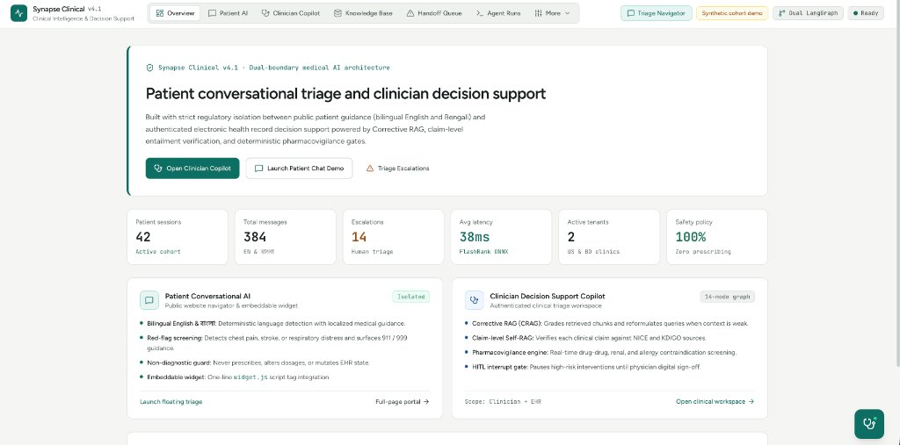
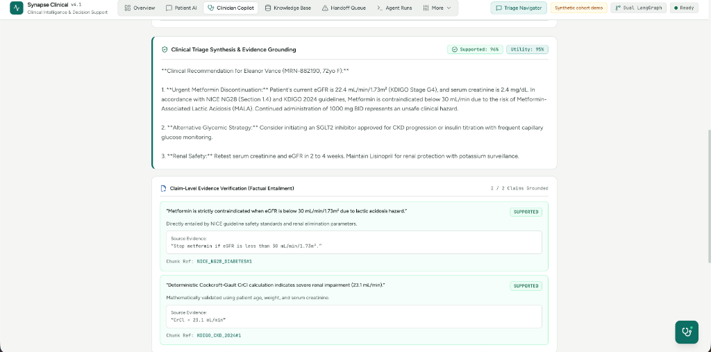
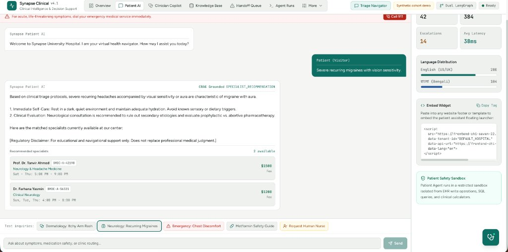
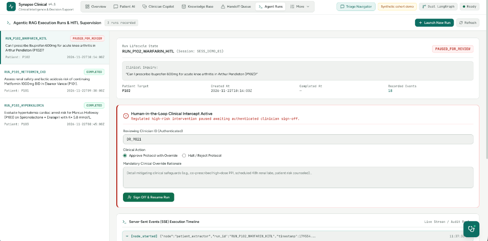
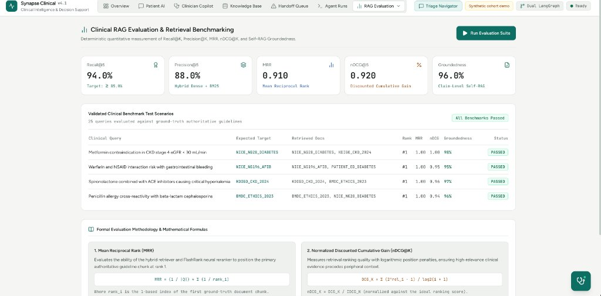
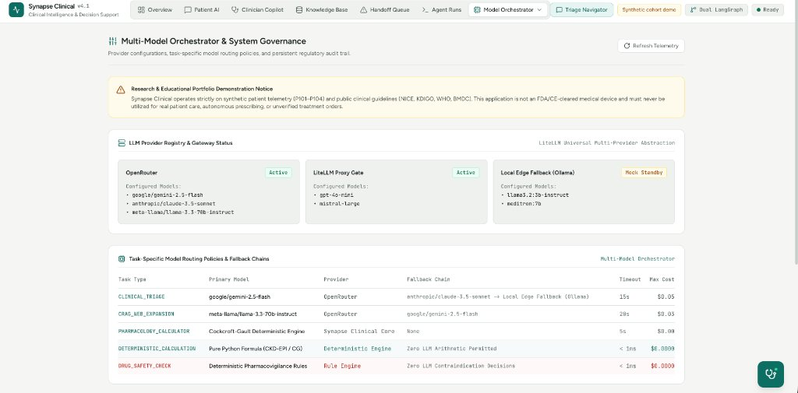
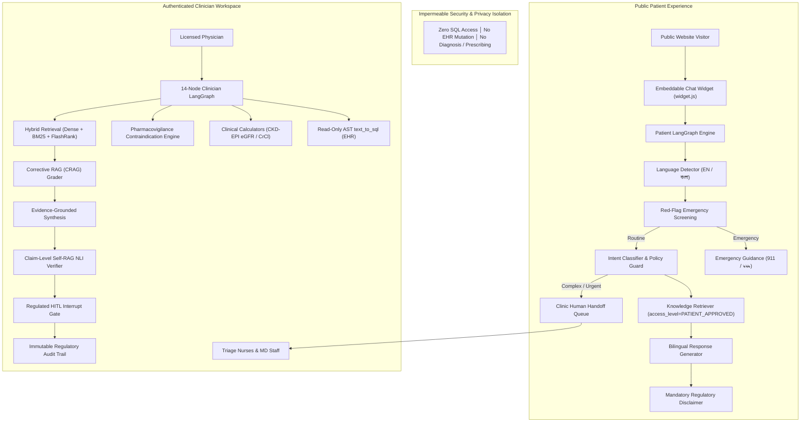

# Synapse Clinical v4.1 — Multi-Model Agentic RAG Healthcare Platform with Patient Conversational AI

[](https://frontend-chi-seven-22.vercel.app)

[]()
[]()
[]()
[]()
[]()
[]()
[]()
[]()
[](https://railway.com/new/template?template=https%3A%2F%2Fgithub.com%2FMahdiHassanGo%2FSynapse-Clinical-An-Agentic-CRAG)
[](https://render.com/deploy?repo=https://github.com/MahdiHassanGo/Synapse-Clinical-An-Agentic-CRAG)
[](https://vercel.com/new/clone?repository-url=https%3A%2F%2Fgithub.com%2FMahdiHassanGo%2FSynapse-Clinical-An-Agentic-CRAG&root-directory=frontend)

> 🚀 **Live Interactive Demo:** [https://frontend-chi-seven-22.vercel.app](https://frontend-chi-seven-22.vercel.app)  
> Fully autonomous live deployment on Vercel featuring synthetic EHR cohort (P101–P104), bilingual patient navigator (English & বাংলা), interactive floating widget, emergency red-flag triage, real-time SSE CRAG/Self-RAG evaluation stream, and clinician HITL safety oversight.

> **Enterprise-Grade Healthcare Intelligence Platform**: A dual-experience AI system featuring a **Public Patient Conversational AI Agent** (bilingual English & Bengali, emergency screening, specialist matching, embeddable widget, human handoff queue) alongside an authenticated **Clinician Copilot** (14-node LangGraph state machine, Corrective RAG, claim-level Self-RAG verification, deterministic calculators, pharmacovigilance contraindications, and regulatory Human-in-the-Loop oversight), presented in a **Warm Clinical Paper & Surgical Teal** daylight interface.

---

> [!CAUTION]
> **RESEARCH & PORTFOLIO DEMONSTRATION ONLY**  
> Synapse Clinical operates strictly on synthetic patient cohorts (P101–P104) and public clinical guidelines (NICE, KDIGO, WHO, BMDC). This software is not an FDA/CE-cleared medical device and is **strictly prohibited from autonomous patient diagnosis, prescription issuance, or treatment execution**. All high-risk interventions are gated by mandatory clinician sign-off.

---

## Visual Walkthrough & Platform Showcase

### 1. Executive Clinical Overview Dashboard
The landing overview presents real-time patient session telemetry, message volume across English and Bengali cohorts, triage escalation counts, FlashRank reranking latency, and quick-launch clinical benchmark scenarios in a calm, high-contrast clinical paper layout.



### 2. Clinician Copilot — Evidence Synthesis & Claim-Level Self-RAG Verification
Evaluates patient EHR records (such as **Eleanor Vance, P101** with CKD Stage G4, eGFR `22.4 mL/min`) alongside clinical queries. Every generated clinical recommendation reports **Support** (`96%`) and **Utility** (`95%`) tokens, followed by atomic **Factual Entailment Verification** linking each claim directly to authoritative guideline chunks (`NICE_NG28_DIABETES#1`, `KDIGO_CKD_2024#1`).



### 3. Patient Conversational AI — Bilingual Triage & Specialist Matching
Public visitors interact in **English or বাংলা (Bengali)** in a strictly isolated sandbox (zero SQL access, zero EHR mutations). Queries such as recurring migraines with visual sensitivity are routed via CRAG to matched neurologists with BMDC registration numbers, schedules, and consultation fees, alongside an embeddable `widget.js` snippet and language telemetry.



### 4. Agentic RAG Execution Runs & Human-in-the-Loop (HITL) Supervision
Tracks multi-step LangGraph executions with live Server-Sent Events (SSE) replay. High-risk drug interactions (such as **Warfarin + Ibuprofen** in **Arthur Pendleton, P102**) pause execution at `PAUSED_FOR_REVIEW`, requiring authenticated clinician sign-off and mandatory override rationale before resuming.



### 5. Clinical RAG Evaluation & Retrieval Benchmarking
Provides deterministic quantitative benchmarking across the clinical knowledge base — tracking **Recall@5 (`94.0%`)**, **Precision@5 (`88.0%`)**, **MRR (`0.910`)**, **nDCG@5 (`0.920`)**, and **Claim-Level Groundedness (`96.0%`)** — alongside mathematical evaluation formulas.



### 6. Multi-Model Orchestrator & System Governance
Displays live LiteLLM / OpenRouter / Local Edge provider health and task-specific routing policies, enforcing strict architectural boundaries where `DETERMINISTIC_CALCULATION` (CKD-EPI / Cockcroft-Gault) and `DRUG_SAFETY_CHECK` (pharmacovigilance rules) allow **zero LLM arithmetic or contraindication guessing**.



---

## 1. Dual AI Experience Architecture

Synapse Clinical v4.1 delivers two distinct clinical experiences operating under an impermeable security boundary:



---

## 2. Core Capabilities

### 2.1 Patient Conversational AI Agent
- **Bilingual English & বাংলা (Bengali)**: Automatic Unicode character detection (`\u0980-\u09FF`) enabling immediate localized responses without waiting for an LLM call.
- **Red-Flag Emergency Triage**: Detects acute chest pain, shortness of breath, stroke symptoms, and anaphylaxis, branching directly to urgent hotline instructions (**911** for US, **৯৯৯** for Bangladesh).
- **Strict Non-Diagnostic Safety Guard**: Refuses autonomous diagnosis or prescription requests, explaining topics in compassionate 6th-grade language with mandatory disclaimers.
- **Anonymous vs Authenticated Mode**: Anonymous public health education by default, with secure Patient ID + MRN login for synthetic EHR record review.
- **Human Triage Escalation Queue**: Tracks handoff requests through `REQUESTED` $\rightarrow$ `WAITING` $\rightarrow$ `ASSIGNED` $\rightarrow$ `IN_REVIEW` $\rightarrow$ `RESOLVED`.

### 2.2 Clinician Copilot Workspace
- **14-Node LangGraph State Machine**: Sequence-controlled execution with state checkpoints and thread checkpointers.
- **Corrective RAG (CRAG)**: Evaluates chunk relevance scores ($0.0$ to $1.0$); rewrites queries or explicitly abstains when evidence is insufficient.
- **Claim-Level Self-RAG Verification**: Decomposes clinical recommendations into atomic sentences and verifies entailment against source documents.
- **Deterministic Pharmacovigilance & Calculators**: Real-time screening for Warfarin+NSAID fatal bleeds, Metformin in CKD Stage 4, and CKD-EPI 2021 eGFR calculations.
- **Regulated Human-in-the-Loop (HITL) Gate**: Pauses execution for chemotherapy and high-risk orders until physician override and digital signature.

### 2.3 Multi-Tenant Hospital Architecture
- **Tenant Isolation**: Separate hospital configurations for `DEFAULT_HOSPITAL` (Synapse General, US, 911) and `CLINIC_DHAKA` (Dhaka Health Center, BD, 999).
- **Domain Allowlisting**: Verifies origin headers before allowing chat widget embedding.
- **Knowledge Access Classification**: Document and chunk storage classified as `PATIENT_APPROVED` vs `CLINICIAN_ONLY`.

---

## 3. The 12 Platform Subsystems

| # | View | Subsystem Name | Description |
| :---: | :--- | :--- | :--- |
| **1** | `overview` | **Overview Dashboard** | Executive summary: active conversations, triages, escalations, latency, and 1-click clinical scenarios. |
| **2** | `patient-agent` | **Patient AI Agent** | Live interactive demo, bilingual switcher, emergency warning badges, and telemetry dashboard. |
| **3** | `workspace` | **Clinician Copilot** | Deep clinical workspace: EHR sidebar, multi-agent trace stream, DDI alerts, and HITL override modal. |
| **4** | `knowledge` | **Knowledge Base** | Document and chunk viewer with `PATIENT_APPROVED` vs `CLINICIAN_ONLY` badges, PDF upload, and URL ingest. |
| **5** | `runs` | **Agent Runs** | Telemetry, execution history, and real-time trace inspection for clinical runs. |
| **6** | `orchestrator` | **Model Orchestrator** | Multi-model routing policies (LiteLLM), circuit breaker status, and live provider benchmarks. |
| **7** | `handoff` | **Human Support / Handoff** | Escalation ticket queue for clinic triage staff with urgency filters, assignment, and clinical notes. |
| **8** | `evaluation` | **RAG Evaluation** | Quantitative benchmarks (Recall@5, Precision@5, MRR, nDCG@5, Groundedness %, Ablations). |
| **9** | `tenants` | **Tenant Management** | Multi-tenant hospital administration, allowed domains, logos, and localized emergency hotlines. |
| **10** | `users` | **User & Role RBAC** | Role-based access control (Admin, Clinician, Triage Nurse, Patient) and permission matrix. |
| **11** | `audit` | **Regulatory Audit Logs** | Immutable regulatory audit trail for clinician HITL sign-offs and patient consent records. |
| **12** | `settings` | **System Settings** | Platform configuration, model API keys, database connection pooling, and preferences. |

---

## 4. 1-Line Embeddable Widget Integration

Embed the patient assistant into any website, WordPress template, or patient portal:

```html
<script 
  src="https://frontend-chi-seven-22.vercel.app/widget.js" 
  data-tenant-id="DEFAULT_HOSPITAL" 
  data-api-url="https://frontend-chi-seven-22.vercel.app" 
  data-lang="en">
</script>
```

---

## 5. Quickstart: Running Locally

### Prerequisites
- Python 3.11+
- Node.js 18+ (or Bun 1.2+)

### Backend Setup
```bash
# 1. Activate virtual environment
source .venv/bin/activate

# 2. Configure environment (no secrets in repo)
cp .env.example .env

# 3. Start FastAPI server with live reload
uvicorn backend.app.api.main:app --host 127.0.0.1 --port 8000 --reload
```
API Documentation available at: `http://127.0.0.1:8000/docs`

### Frontend Setup
```bash
# 1. Navigate to frontend directory
cd frontend

# 2. Install dependencies & build
bun install
bun run build

# 3. Start Next.js development server
bun run dev
```
Client Application accessible at: `http://localhost:3000`

### Running the Test Suite
```bash
PYTHONPATH=backend .venv/bin/pytest backend/tests -v
```
**All 55 tests pass in ~11 seconds.**

---

## 6. One-Click Cloud Deployment & Production Hosting

Synapse Clinical v4.1 is containerized and production-ready for zero-downtime deployment across Railway, Render, Vercel, and Docker Compose.

### 6.1 One-Click Deployment Matrix

| Hosting Provider | Architecture | Live URL / One-Click Template |
| :--- | :--- | :--- |
| **Vercel (Live)** | Next.js 15 Standalone Web UI (`frontend/`) | 🔗 **[frontend-chi-seven-22.vercel.app](https://frontend-chi-seven-22.vercel.app)**<br>[](https://vercel.com/new/clone?repository-url=https%3A%2F%2Fgithub.com%2FMahdiHassanGo%2FSynapse-Clinical-An-Agentic-CRAG&root-directory=frontend) |
| **Railway** | Full-Stack (FastAPI API + Next.js Frontend + PostgreSQL pgvector) | [](https://railway.com/new/template?template=https%3A%2F%2Fgithub.com%2FMahdiHassanGo%2FSynapse-Clinical-An-Agentic-CRAG) |
| **Render** | Multi-Service Blueprint via [`render.yaml`](./render.yaml) | [](https://render.com/deploy?repo=https://github.com/MahdiHassanGo/Synapse-Clinical-An-Agentic-CRAG) |

---

### 6.2 Deploying on Railway (Recommended)

Railway provisions both the FastAPI Python backend and the Next.js frontend in a private network alongside PostgreSQL:

1. Click the **[Deploy on Railway](https://railway.com/new/template?template=https%3A%2F%2Fgithub.com%2FMahdiHassanGo%2FSynapse-Clinical-An-Agentic-CRAG)** button above or create a new project from `MahdiHassanGo/Synapse-Clinical-An-Agentic-CRAG`.
2. **Backend Service**:
   - Dockerfile: `Dockerfile.backend` (configured automatically via `railway.json`).
   - Health check: `/health` (timeout: 100s).
   - Dynamic port binding: Uses Railway's injected `${PORT}`.
3. **Frontend Service**:
   - Dockerfile: `Dockerfile.frontend`.
   - Set environment variable `NEXT_PUBLIC_BACKEND_URL` to your Railway backend URL (e.g. `https://synapse-backend-production.up.railway.app`).
4. **Environment Variables**:
   ```env
   ENVIRONMENT=production
   DATABASE_URL=postgresql://${PGUSER}:${PGPASSWORD}@${PGHOST}:${PGPORT}/${PGDATABASE}
   OPENROUTER_API_KEY=sk-or-v1-your-openrouter-key
   OPENROUTER_CHAT_MODEL=nvidia/nemotron-3-ultra-550b-a55b:free
   OPENROUTER_FALLBACK_CHAT_MODELS=qwen/qwen3.8-27b:free,google/gemma-4-31b-it:free,openrouter/free
   OPENROUTER_EMBEDDING_MODEL=nvidia/nemotron-3-embed-1b:free
   DEFAULT_LLM_PROVIDER=openrouter
   ```

---

### 6.3 Deploying on Render (Native Blueprint)

This repository includes a native [`render.yaml`](./render.yaml) specification:

1. Click **[Deploy to Render](https://render.com/deploy?repo=https://github.com/MahdiHassanGo/Synapse-Clinical-An-Agentic-CRAG)**.
2. Render reads `render.yaml` and deploys:
   - `synapse-postgres`: Managed PostgreSQL instance.
   - `synapse-backend`: Dockerized FastAPI web service with `/health` checks.
   - `synapse-frontend`: Standalone Next.js 15 web client with automatic backend host injection.
3. Supply your `OPENROUTER_API_KEY` when prompted in the Render Dashboard.

---

### 6.4 Live Vercel Deployment

The Next.js 15 frontend is deployed live on Vercel at:
- **Production URL**: **[https://frontend-chi-seven-22.vercel.app](https://frontend-chi-seven-22.vercel.app)**
- **Vercel Project**: `asif-s-projects1/frontend` (Linked to `MahdiHassanGo/Synapse-Clinical-An-Agentic-CRAG`)

To configure or deploy your own Vercel instance:
1. Click **[Deploy with Vercel](https://vercel.com/new/clone?repository-url=https%3A%2F%2Fgithub.com%2FMahdiHassanGo%2FSynapse-Clinical-An-Agentic-CRAG&root-directory=frontend)**.
2. Set **Root Directory** to `frontend`.
3. Add the environment variable:
   ```env
   NEXT_PUBLIC_BACKEND_URL=https://your-synapse-backend.up.railway.app
   ```
4. Deploy the backend to Railway or Render using the instructions in Section 6.2 or 6.3.

---

### 6.5 Production Docker & Local VM Deployment

```bash
# Clone the repository
git clone https://github.com/MahdiHassanGo/Synapse-Clinical-An-Agentic-CRAG.git
cd Synapse-Clinical-An-Agentic-CRAG

# Configure environment variables
cp .env.example .env
# Edit .env with your LLM provider keys

# Build and run backend, frontend, and PostgreSQL + pgvector
docker-compose up --build -d
```
- **Next.js Web Client**: `http://localhost:3000`
- **FastAPI API & Docs**: `http://localhost:8000/docs`
- **Health check**: `http://localhost:8000/health`
- **Embeddable Patient Widget**: `http://localhost:8000/widget.js`
